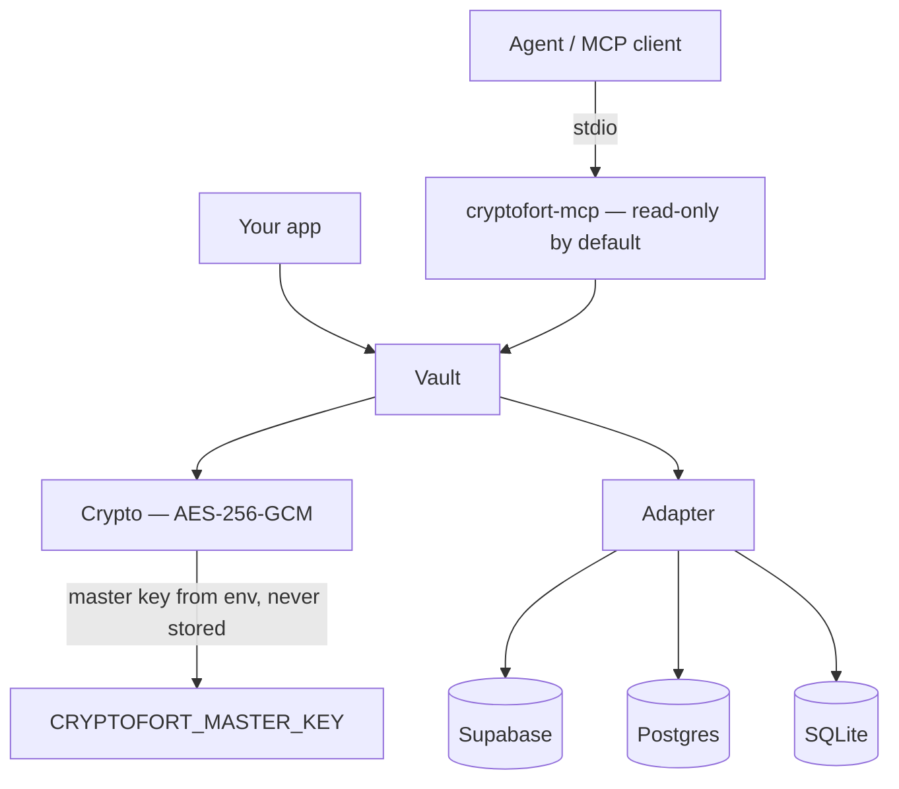

<p align="center">
  
</p>

<h1 align="center">CryptoFort</h1>

<p align="center">
  <b>An encrypted-at-rest credential vault with an MCP server for agents.</b>
</p>
<p align="center">
  AES-256-GCM secrets, a pluggable database backend, and a metadata-only-by-default<br />
  MCP server — so agents can find the credential they need without ever holding its value.
</p>

<p align="center">
  <a href="https://www.npmjs.com/package/cryptofort"></a>
  <a href="https://github.com/bradley-t-t/cryptofort/pkgs/npm/cryptofort"></a>
  <a href="LICENSE"></a>
  =20" />
  
  
</p>

<br />

## Why CryptoFort

Secrets sprawl across `.env` files, shell history, and plaintext columns — and agents have no safe, structured way to ask for them. CryptoFort seals every secret with authenticated encryption, keeps the key out of the database entirely, and hands agents an MCP interface that returns metadata and nothing else. A conversational agent keeps whatever it is told, so the value itself is reached by a process that runs one operation with it, not by the agent that decided to run it.

<table width="100%">
  <tr>
    <td width="33%" valign="top">
      <h3 align="center">Encrypted at rest</h3>
      <p align="center">Every secret is sealed with AES-256-GCM. The master key lives only in the environment, so a database dump is inert on its own.</p>
    </td>
    <td width="33%" valign="top">
      <h3 align="center">Agent-native</h3>
      <p align="center">A built-in MCP server exposes <code>search</code> and <code>list</code> by default. Reading a secret, writing, and deleting are three separate opt-ins.</p>
    </td>
    <td width="33%" valign="top">
      <h3 align="center">Backend-agnostic</h3>
      <p align="center">The same vault runs on Supabase, SQLite, or any Postgres. Switch backends with a single environment variable.</p>
    </td>
  </tr>
</table>

<br />

## Stack

| Layer           | Technology                                                                    |
| :-------------- | :---------------------------------------------------------------------------- |
| Language        | TypeScript 5, ESM-first with a CJS build                                      |
| Encryption      | Web Crypto (`crypto.subtle`) — AES-256-GCM, 32-byte key from the environment  |
| Validation      | Zod 4 (MCP tool schemas)                                                      |
| Agent interface | `@modelcontextprotocol/sdk` over stdio, metadata-only by default              |
| Backends        | `@supabase/supabase-js`, `postgres`, or `better-sqlite3` — all optional peers |
| Build           | tsup (ESM + CJS + `.d.ts`)                                                    |
| Tests           | Vitest                                                                        |
| Runtime         | Node 20 or newer                                                              |

## Getting started

### Install

```bash
npm install cryptofort
# plus the driver for your backend:
npm install @supabase/supabase-js   # or: better-sqlite3 | postgres
# and, to run the MCP server:
npm install @modelcontextprotocol/sdk
```

Every driver — and the MCP SDK — is an **optional peer dependency**, so nothing is pulled in that you do not use. Requires Node 20 or newer.

<details>
<summary>Install from GitHub Packages instead</summary>

CryptoFort is also published to GitHub Packages as `@bradley-t-t/cryptofort`. Point the `@bradley-t-t` scope at the GitHub registry and authenticate with a token that has `read:packages` — GitHub Packages requires auth even for public packages:

```ini
@bradley-t-t:registry=https://npm.pkg.github.com
//npm.pkg.github.com/:_authToken=${GITHUB_TOKEN}
```

```bash
npm install @bradley-t-t/cryptofort
```

</details>

## Documentation

The rest of this page is the tour. [`docs/`](docs/) is the manual.

| Page                                       | Covers                                                                       |
| :----------------------------------------- | :--------------------------------------------------------------------------- |
| [Getting started](docs/getting-started.md) | Install, generate a key, store and read a credential, wire up an MCP client. |
| [Configuration](docs/configuration.md)     | Every environment variable, and what CryptoFort refuses to accept.           |
| [Library API](docs/api.md)                 | `Vault`, `Crypto`, the adapters, and every exported type.                    |
| [MCP server](docs/mcp.md)                  | The six tools, the three permission flags, and client configuration.         |
| [Backends](docs/backends.md)               | Supabase, Postgres, and SQLite — setup, schema, and how they differ.         |
| [Security model](docs/security.md)         | The threat model, key rotation, and what is deliberately not protected.      |
| [Troubleshooting](docs/troubleshooting.md) | Every error CryptoFort raises, what it means, and how to clear it.           |

## Library usage

```ts
import { Vault, Crypto, SqliteAdapter } from 'cryptofort';

const adapter = new SqliteAdapter('vault.db');
await adapter.init();

const vault = new Vault({
  adapter,
  crypto: new Crypto({ key: process.env.CRYPTOFORT_MASTER_KEY! }),
});

await vault.put({
  name: 'stripe-secret-key',
  secret: 'sk_live_…',
  provider: 'stripe',
  tags: ['payments'],
});
await vault.search('stripe'); // metadata only — never the secret
await vault.get('stripe-secret-key'); // the decrypted secret
```

CryptoFort encrypts only the `secret` field. `name`, `description`, `provider`, `tags` and `metadata` stay plaintext so search works without the master key. Never put a secret in one of them. [Getting started](docs/getting-started.md) covers generating the master key, expiry, and namespaces.

## MCP server

The MCP server needs `@modelcontextprotocol/sdk` installed alongside CryptoFort. Point any MCP client at the `cryptofort-mcp` binary:

```json
{
  "mcpServers": {
    "cryptofort": {
      "command": "cryptofort-mcp",
      "env": {
        "CRYPTOFORT_ADAPTER": "supabase",
        "SUPABASE_URL": "https://<ref>.supabase.co",
        "SUPABASE_SERVICE_ROLE_KEY": "<service-role-key>",
        "CRYPTOFORT_MASTER_KEY": "<base64-32-bytes>"
      }
    }
  }
}
```

The server serves **metadata only** by default: it can say what the vault holds, and nothing that would tell you a secret. Three flags widen that, and they are separate because they answer different questions.

- `"args": ["--allow-secret-read"]` exposes `credential_get`, which returns a decrypted secret to whoever called it. Give it to a process that will use the value and exit — not to an agent whose conversation is written to disk, because a secret handed to one stays in that transcript for as long as the transcript does.
- `"args": ["--allow-write"]` exposes `credential_put` and `credential_purge_expired`. A put can be put again, and a purge only removes what an expiry had already killed.
- `"args": ["--allow-delete"]` exposes `credential_delete`. It is separate because it is the one call the vault cannot answer for afterwards: the secret is gone and no copy is kept.

With no flag the server registers only `credential_search` and `credential_list`. The [MCP server page](docs/mcp.md) documents all six tools, and the [configuration page](docs/configuration.md) every environment variable.

## Architecture



## Contributing

Branch off `develop`, open the pull request against `develop`, and run what CI
runs before you push:

```bash
npm ci
npm run format:check && npm run lint && npm run typecheck && npm test && npm run build
```

[CONTRIBUTING.md](CONTRIBUTING.md) covers the rest: the checks, the branch flow,
and how to add a backend adapter or an MCP tool.

## Security

Report a vulnerability through a
[private security advisory](https://github.com/bradley-t-t/cryptofort/security/advisories/new),
never a public issue. [SECURITY.md](SECURITY.md) has the process, and
[the security model](docs/security.md) says what CryptoFort protects and what it
deliberately does not.

## License

Released under the [MIT License](LICENSE).

<br />

<p align="center">
  <sub>Secrets sealed at rest — used by agents, held by none of them.</sub>
</p>
